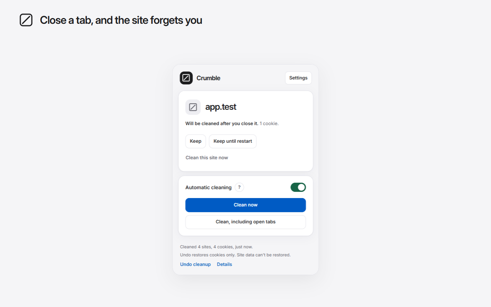

# Crumble: Auto-Delete Cookies on Tab Close

Crumble is a privacy-focused Manifest V3 extension for Chromium browsers. It removes a site's cookies and optional site data shortly after its last tab closes, while keeping the sites you trust signed in.

It is designed as a modern, independently built successor for people who miss Cookie AutoDelete. Crumble can import Cookie AutoDelete rule lists, but it is not affiliated with that project and does not reuse its code.

## What it does

- Deletes first-party, third-party, and partitioned (CHIPS) cookies after a site's last tab closes.
- Optionally clears LocalStorage, IndexedDB, Cache Storage, and Service Workers.
- Supports **Keep** and **Keep until restart** rules, including domain, wildcard, and regular-expression patterns.
- Imports Cookie AutoDelete exports and can export Crumble rules for backup.
- Provides a cleanup log and a two-minute cookie undo window.
- Recovers pending cleanups after the Manifest V3 service worker sleeps or the browser restarts.
- Includes manual cleaning, context-menu actions, a keyboard command, badges, and light/dark themes.
- Makes no network requests and contains no analytics, advertising, or account system.

## How cleanup works

When the last tab for a site closes, Crumble waits for the configured delay and checks whether the site is still in use. It then applies the matching Keep and Keep until restart rules, with Keep taking priority. Kept cookies are left alone; other cookies and selected site-data types are removed according to the rules and settings. A backup browser alarm ensures scheduled work survives service-worker suspension.

Cookie removal is verified by reading the cookie store again and retrying once when necessary. Cleanup jobs run one at a time, and overlapping triggers are merged to avoid races.

## Install from source

Requirements: Node.js 22 or newer and a current Chromium-based browser.

1. Clone this repository and open its folder.
2. Run `npm ci`.
3. Run `npm run build`.
4. Open `chrome://extensions` (or the equivalent page in your browser).
5. Enable **Developer mode**, choose **Load unpacked**, and select the generated `dist/` folder.

The checked-in manifest source is `src/manifest.json`; the repository root is not itself a loadable extension.

## Browser support

Crumble targets Chrome 130+ and other current Chromium browsers, including Edge, Brave, Vivaldi, and Opera. Firefox and Safari are not currently supported.

## Development

| Command | Purpose |
|---|---|
| `npm run build` | Build the production extension into `dist/` |
| `npm test` | Typecheck, lint, build, and run unit and browser tests |
| `npm run test:unit` | Run the Vitest unit suite |
| `npm run test:e2e` | Run Playwright end-to-end tests |
| `npm run screenshots` | Regenerate documentation screenshots |
| `npm run icons` | Regenerate extension icons |
| `npm run package` | Create `release/crumble-<version>.zip` |
| `npm run site` | Build the GitHub Pages site into `dist-site/` |

End-to-end tests launch an isolated Playwright Chromium profile and local `*.test` sites. They never use your personal browser profile. The local test server needs port 443.

## Project structure

| Path | Contents |
|---|---|
| `src/background/` | Service worker, triggers, scheduler, cleanup engine, badge, and menus |
| `src/core/` | Rules, decisions, settings, domains, logging, and import/export |
| `src/ui/` | Popup, settings, welcome flow, and shared UI helpers |
| `tests/unit/` | Fast logic and contract tests |
| `tests/e2e/` | Installed-extension tests in Chromium |
| `tests/harness/` | Research harness retained for browser-behaviour regression checks |
| `assets/` | Source and generated icon assets |
| `site/` | Landing, privacy, permissions, uninstall, and changelog pages |
| `store/` | Web Store copy and promotional artwork |
| `docs/` | Architecture decisions, privacy, permissions, tests, and release guidance |

## Documentation

- [Product requirements and build specification](crumble-cookie-cleaner-PRD.md)
- [Build report](BUILD-REPORT.md)
- [Technical decisions](docs/DECISIONS.md)
- [Design system and UI review](docs/DESIGN.md)
- [Privacy policy](docs/PRIVACY.md)
- [Permission explanations](docs/PERMISSIONS.md)
- [Automated test results](docs/TEST-RESULTS.md)
- [Manual test plan](docs/MANUAL-TESTS.md)
- [Release checklist](docs/RELEASE-CHECKLIST.md)
- [Changelog](CHANGELOG.md)

## Privacy and safety

All settings, rules, and logs remain on the local device. Crumble does not transmit browsing activity, domains, cookies, or telemetry. Broad browser permissions are required because cleanup must work across the sites the user visits; each permission is explained in [docs/PERMISSIONS.md](docs/PERMISSIONS.md).

Use a fresh browser profile for manual testing so test cleanups cannot affect personal sessions. See [FINAL-TEST.md](FINAL-TEST.md) for the 15-minute acceptance checklist.

## Contributing

Read [CONTRIBUTING.md](CONTRIBUTING.md) before changing cleanup behaviour. Contributions should include tests and keep `npm test` green.

## Inspiration and thanks

Crumble is inspired by [Cookie AutoDelete](https://github.com/Cookie-AutoDelete/Cookie-AutoDelete) and its approach to automatic cookie cleanup and keeping trusted sites. Thank you to its creators, maintainers, and contributors for their work on browser privacy and for making the project open source.

Crumble is an independent Manifest V3 implementation with its own interface. It is not affiliated with or endorsed by Cookie AutoDelete, and does not reuse its code or artwork.

## License

MIT. See [LICENSE](LICENSE). Bundled runtime dependencies are credited in [LICENSE-THIRD-PARTY.md](LICENSE-THIRD-PARTY.md); both licence files are included in the extension ZIP.
